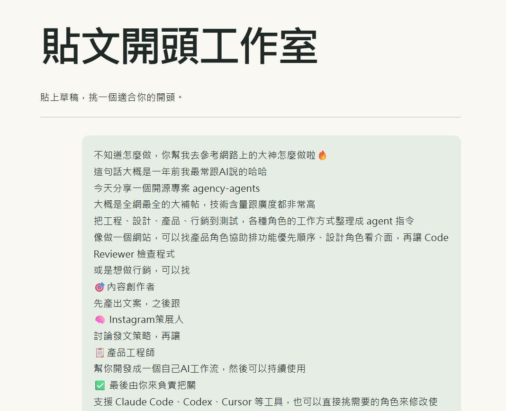
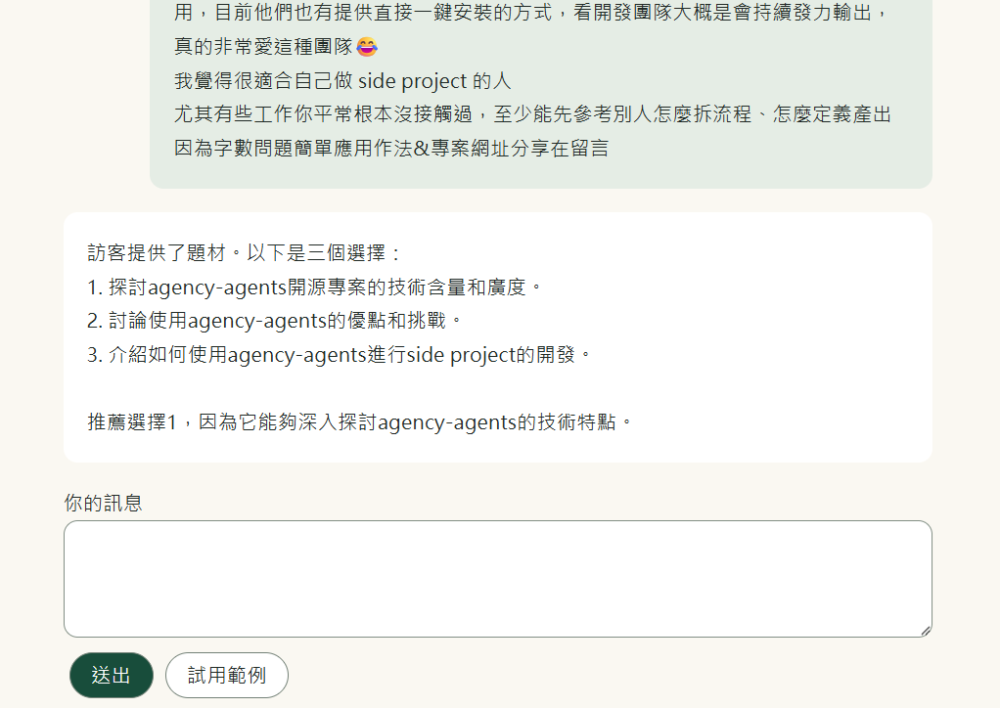
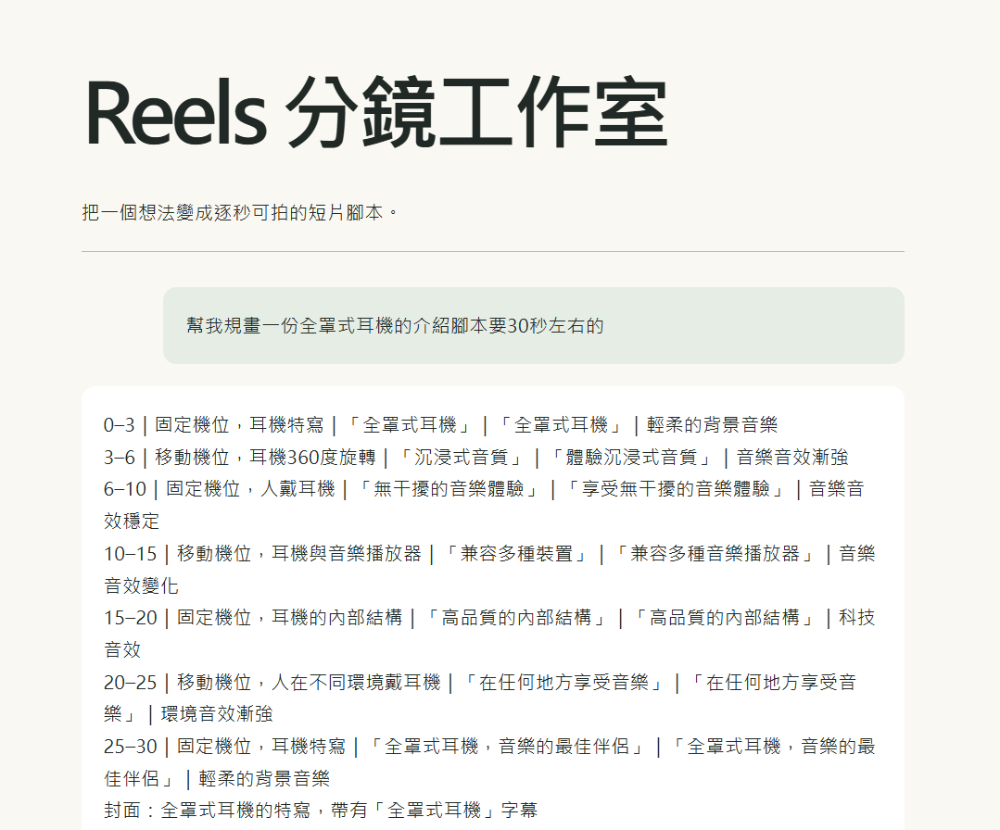
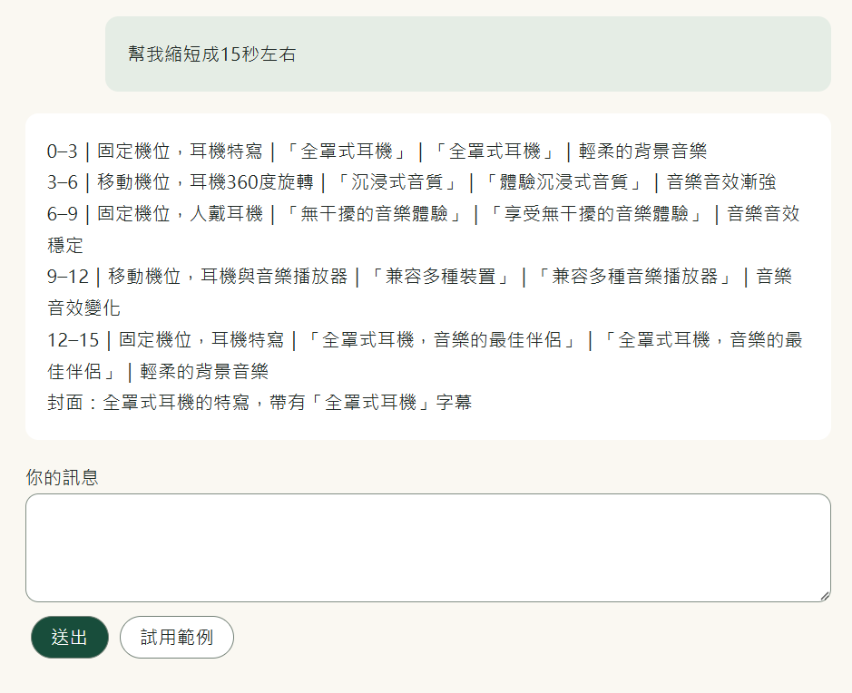

# Wskill

把現有的文字 Skill 變成朋友點開就能用的聊天頁。

作者在自己的 Agent 裡使用 **Wskill Publisher**，部署到自己的 Cloudflare 帳號，取得可分享的 HTTPS 網址。訪客用瀏覽器輸入素材、接著追問，免登入、免安裝 Skill。

## 試用 Demo

| Demo | 可以做什麼 |
| --- | --- |
| [貼文開頭工作室](https://wskill-hook-writer.p19970115.workers.dev) | 貼上 Threads 草稿，取得候選方向與推薦理由。下方以介紹 agency-agents 的草稿示範。 |
| [Reels 分鏡工作室](https://wskill-reels-script.p19970115.workers.dev) | 輸入主題與時長，產生分鏡、字幕、口白與聲音安排。下方示範全罩式耳機介紹，從約 30 秒追問縮短至約 15 秒。 |

兩個 Demo 都可以接著追問、調整文字內容。Reels 交付的是拍攝腳本。

## Demo 畫面

圖片可點開查看原尺寸。

### 貼文開頭工作室

貼上介紹 agency-agents 的草稿，取得三個候選方向與推薦理由。

| 輸入草稿 | 候選方向與推薦理由 |
| --- | --- |
| <a href="docs/images/hook-input.png"></a> | <a href="docs/images/hook-output.png"></a> |

### Reels 分鏡工作室

試用輸入：

> 幫我規畫一份全罩式耳機的介紹腳本要30秒左右的

接著追問：

> 幫我縮短成15秒左右

| 約 30 秒介紹腳本 | 追問縮短至約 15 秒 |
| --- | --- |
| <a href="docs/images/reels-first.png"></a> | <a href="docs/images/reels-followup.png"></a> |

## 發布自己的 Skill

準備 Node.js 22+、Git、Cloudflare 帳號，以及能讀取本機檔案和執行終端機指令的 Agent。部署使用 Cloudflare Workers 與 Workers AI，額度依你的帳號方案計算。

### 1. 取得 Publisher

將專案下載到本機。

```sh
git clone https://github.com/Wayturn/Wskill.git
cd Wskill
npm ci
```

[Publisher 的指令檔](publisher/SKILL.md) 位於 `publisher/SKILL.md`。在你的 Agent 裡貼上以下要求，將路徑換成實際位置。

> 請讀取 /你的路徑/Wskill/publisher/SKILL.md，依照 Wskill Publisher 的流程，把 /你的路徑/my-skill 部署到我的 Cloudflare，給我可分享的聊天網址。請先檢查依賴，完成後回報部署結果、實際範例回覆與尚未通過的驗收。

也可以依所用 Agent 的 Skill 安裝方式加入此指令檔。各 Agent 的安裝位置不同，直接提供完整路徑即可讓 Agent 讀取流程。

### 2. 準備發布設定

Agent 會參照 [hook-writer 設定](examples/hook-writer/publish.json)，在你的 Skill 附近建立 `publish.json`。設定包括 Skill 路徑、品牌與語氣檔、頁面標題、範例輸入，以及獨立且固定的 Worker 名稱。

- `skill` 指向含有 `SKILL.md` 的資料夾。
- `brand`、`voice` 指向品牌與語氣 Markdown 檔，目前發布流程需要這兩個檔案。
- 檔案路徑以 `publish.json` 所在位置為基準。
- 只打包適合公開使用的內容，並保留 Skill 所需的參考檔與來源授權。
- 更新時沿用同一 Worker 名稱，即可更新同一網址。

Publisher 會先檢查與打包，首次需要時引導你在 Cloudflare 完成授權，再部署及試跑。

### 3. 確認分享結果

發布完成後，確認拿到聊天網址、首輪實際回覆、追問結果，以及新訪客從空白對話開始的驗證結果。部署成功與 Skill 試跑結果應分別回報，未通過項目需附原因。

## 手動部署與開發

在 Wskill 專案根目錄執行，以下命令會將兩個範例各自部署成一個聊天頁。

```sh
npm ci
npx wrangler login
npm run publish-skill -- examples/hook-writer/publish.json --deploy
npm run publish-skill -- examples/reels-script/publish.json --deploy
```

遠端終端機可使用 `npx wrangler login --device`。自訂 Skill 可傳入自己設定檔的絕對路徑。

```sh
npm run publish-skill -- /absolute/path/to/publish.json --build
npm run publish-skill -- /absolute/path/to/publish.json --deploy
```

`--build` 會檢查檔案並執行 Wrangler dry run。開發測試可執行 `npm test`。

## 目前支援與限制

- 已實測文字輸入、文字輸出、追問，以及兩個內建 Demo。圖片、音訊與影片成品尚未驗收。
- 發布器會打包 Skill 指令及其中符合 `references/*.md` 路徑格式的參考檔。其他腳本、外部服務與媒體需求需要另行確認相容性。
- Reels 的開場會先單獨呼叫 hook-writer，再將結果交給主模型。目前跨 Skill 流程支援這個特定子任務。
- 對話只保留在目前分頁的記憶體，重新整理會清空。推論附帶最近兩輪內容。
- 每次請求受來源 IP 速率限制，Workers AI 用量受 Cloudflare 帳號額度限制。2026-11-17 部署過程未升級方案，帳號是否為免費方案尚未獨立核實。
- 2026-11-17 首輪正式站測試已保存。後續補拍截圖時，hook-writer 雖符合 20 字限制並保留「試握」，改寫卻更接近第三個候選，對指定第二句的修改只能算部分通過。模型輸出仍需人工核對。

## 測試與驗收

[2026-11-17 正式站測試紀錄](tests/evidence/2026-11-17.json) 包含實際輸入、輸出與執行步驟。測試使用合成品牌素材；真實使用者是否採用內容仍待驗證。下方結果表保留首輪紀錄，後續重測限制以上方說明為準。

<details>
<summary>展開 H1 / R1 完整驗收規格與首輪結果</summary>

### 共同測試流程

1. 記錄上游 commit、Publisher 版本與所用模型。從該版本的 Skill 資料夾開始，保留原始指令及 references。使用可公開的測試品牌檔 brand-profile.md（週末市集手作杯攤位，讀者是附近居民）與 voice.md（繁體中文、短句、不用驚嘆號）。這是合成測資。
2. 作者在原有 Agent 呼叫 Publisher，首次完成 Cloudflare 授權。驗收者確認部署與推論皆使用作者的免費資源，未接外部付費服務。從回傳的公開網址提交下表案例並保存實際輸出。
3. 在新的無痕工作階段開啟同一網址，應從空白對話開始。用另一段素材完成任務，確認沒有前一訪客的內容。原工作階段可延續修改。
4. 在測試副本移除必讀的評分參考檔再發布。Publisher 應指出缺檔路徑及補救方式，或補齊後重新驗證；依賴未解決時不得回報已驗收。

### H1 · hook-writer

- 輸入：「幫這篇 Threads 草稿寫開頭：這週六我會帶兩款手作杯去市集。兩款容量相同，握把寬度不同，可以到攤位試握。」
- 通過：交付 2–3 個切角不同的開頭，推薦其中一個並說明理由。內容可回溯到草稿，符合 voice.md；不可自行加上售罄、優惠或銷量。上游的 5–10 個候選屬於挑選過程。
- 追問：「把第二個縮成 20 字以內，保留試握這個重點。」驗收者核對所指版本、字數與事實。
- 邊界：「幫我寫個會紅的開頭。」另開對話測試，應要求補充素材，避免憑空編出商品故事。

### R1 · reels-script

- 輸入：「用上面測試品牌的設定，寫 20 秒 IG Reels，邀人週六到市集試握兩款手作杯。兩款容量相同，握把寬度不同。我可以自己入鏡和配音。」
- 通過：有可照拍的逐段腳本，包含時間、畫面、字幕、口白與聲音安排，時段連續且合計 20 秒。前三秒有具體開場，靜音只看字幕與畫面也看得懂兩款杯子的差異及邀請，附封面構想。
- 追問：「我只有一支手機和固定腳架，改成單鏡位，仍然 20 秒。」新版每段都能在同一機位拍攝，且保留原任務、時長與品牌語氣。
- 依賴：保存載入 hook-writer 與相關參考資料的執行紀錄，確認跨 Skill 的開場步驟確實執行。此案例交付拍攝腳本；影片生成與社群發佈另行驗收。

### 結果紀錄

| 案例 | 狀態 | 執行日期、版本、部署網址 | 實際輸入、輸出、追問與失敗項 |
| --- | --- | --- | --- |
| H1 | 正式站功能通過 | 2026-11-17 · [試用](https://wskill-hook-writer.p19970115.workers.dev) · a3f39fa0 | 三種開頭、指定縮寫、素材不足追問 |
| R1 | 正式站功能通過 | 2026-11-17 · [試用](https://wskill-reels-script.p19970115.workers.dev) · b6d3a6f8 | 20 秒連續分鏡、單機位改寫、獨立新題材及子任務紀錄 |

[正式站輸入、輸出及執行步驟](tests/evidence/2026-11-17.json)。測試使用合成素材。本次未升級方案，OAuth 無法讀取帳單訂閱以確認免費方案。

每案保留去識別化的測試證據，以共同流程與個別案例全數通過為準。真人是否採用開頭或拿腳本去拍，另記為使用回饋。

</details>

## 來源與授權

Wskill 採用 [MIT License](LICENSE)。

兩個 Demo 改編自 [social-media-skills/skills](https://github.com/social-media-skills/skills) 的 [hook-writer](https://github.com/social-media-skills/skills/tree/main/skills/hook-writer) 與 [reels-script](https://github.com/social-media-skills/skills/tree/main/skills/reels-script)。Wskill 加上訪客聊天頁、發布設定、示範品牌語氣及輸出格式要求。第三方內容依其隨附授權使用，重用時請保留來源與授權聲明。

## 回饋

歡迎透過 [Issues](https://github.com/Wayturn/Wskill/issues) 回報問題。請附上操作步驟、預期與實際結果，並移除憑證及私人素材。
